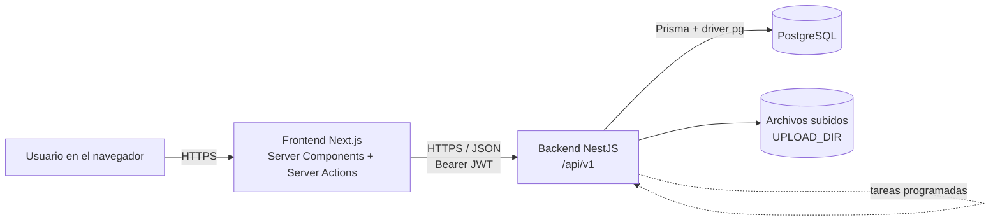

# Arquitectura

## Vista general



El navegador nunca llama a la API directamente: el frontend guarda el JWT en
una cookie httpOnly y llama al backend desde el servidor (Server Components y
Server Actions). Por eso la URL de la API solo la conoce el servidor del frontend.

Tareas programadas dentro del backend (`@nestjs/schedule`):

| Tarea | Frecuencia | Historia |
|---|---|---|
| Cuotas Pendientes → Vencidas | Diaria 00:05 (America/El_Salvador) | H01 |
| Autorizaciones Vigentes → Vencidas | Diaria 23:59 (America/El_Salvador) | H07 |
| Comunicados Programados → Publicados → Expirados | Cada 5 minutos | H13 |

## Stack

| Capa | Tecnología | Versión |
|---|---|---|
| Frontend | Next.js (App Router) + React + Tailwind CSS + Zustand | 16.3 / 19.2 / 4 / 5 |
| Backend | NestJS + Prisma ORM (driver adapter `pg`) | 12 / 7.10 |
| Validación | class-validator + class-transformer | 0.15 / 0.5 |
| Autenticación | JWT (`@nestjs/jwt`) + refresh token rotativo, bcrypt | 12 / 6 |
| Documentación API | `@nestjs/swagger` en `/api/docs` | 12 |
| Base de datos | PostgreSQL | 18 |
| Pruebas | Vitest + Supertest (backend), Vitest + Testing Library (frontend) | 4 / 5 |
| Contenedores | Docker y docker-compose | Compose v2 |
| Runtime | Node.js | 24 |

## Estructura de carpetas

```
gestion_condominios_backend_fresquitop
├── prisma/
│   ├── schema.prisma        # modelo de datos
│   ├── migrations/          # una carpeta por migración
│   └── seed.ts              # datos semilla (roles, usuarios, ejemplos)
├── src/
│   ├── main.ts              # arranque + Swagger
│   ├── app.setup.ts         # prefijo /api/v1 y ValidationPipe (compartido con e2e)
│   ├── auth/                # login, refresh, guards JWT y de rol
│   ├── estado-cuenta/       # H01
│   ├── autorizaciones/      # H07, H07b
│   ├── areas/               # H03
│   ├── paquetes/            # H09
│   ├── reportes/            # H05
│   ├── morosidad/           # H22
│   ├── comunicados/         # H13
│   ├── notificaciones/      # contrato del servicio de avisos (H18)
│   ├── unidades/            # unidades y torres compartidas
│   ├── common/              # utilidades de fechas (zona del negocio)
│   └── <modulo>/
│       ├── controllers/     # HTTP: rutas, roles, Swagger
│       ├── dto/             # validación de entrada y forma de salida
│       ├── services/        # reglas de negocio
│       └── repositories/    # único acceso a Prisma
├── test/                    # pruebas e2e (*.e2e-spec.ts) contra una BD *_test
├── docs/                    # esta documentación
├── Dockerfile
└── docker-compose.yml
```

## Decisiones técnicas

| Decisión | Alternativas consideradas | Motivo |
|---|---|---|
| Capas controller → service → repository por módulo | Llamar a Prisma desde los servicios | Un solo punto de acceso a cada tabla; los servicios se prueban con mocks sin base de datos. |
| JWT corto (15 min) + refresh token rotativo guardado como hash SHA-256 | Sesiones en servidor | API sin estado; si se filtra la base, los refresh tokens guardados no sirven. |
| Rol global por usuario y validado con un guard global (`RolesGuard`) | Permisos por recurso | Un solo condominio; el rol se lee desde la base en cada petición, así un cambio aplica de inmediato. |
| Recurso ajeno responde 404 (no 403) | Responder 403 | No revela qué ids existen (p. ej. “La autorización no existe”). |
| Cambios de estado con `updateMany` condicionado al estado de origen | Leer y luego escribir | Evita carreras (cancelar vs. vencer, editar vs. cancelar) y hace idempotentes las tareas programadas. |
| Fechas de negocio como `date`/`time` y “hoy” calculado en America/El_Salvador | Guardar todo como timestamp UTC | Una visita “el 10 de noviembre” no debe moverse de día por la zona del servidor. |
| Prisma 7 con `engineType = "client"` y driver adapter `pg` | Motor nativo de Rust | Imagen Alpine sin libssl y cliente ESM generado dentro de `src/`. |
| Servicio de notificaciones como clase abstracta (`NotificacionService`) | Llamar a un proveedor concreto | Los módulos que avisan (H09, H13, …) no cambian cuando H18 implemente el envío real. |
| Documentación en `docs/` del repositorio | Wiki de GitHub | La Wiki no está disponible en repositorios privados de cuentas gratuitas. |
