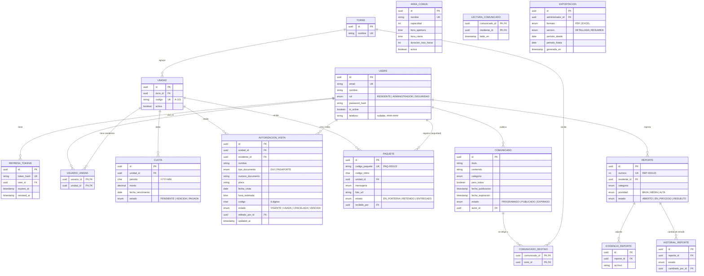

# Modelo de datos

El modelo vive en [`prisma/schema.prisma`](../prisma/schema.prisma) y cada cambio
se aplica con una migración en `prisma/migrations/`. Las reglas que Prisma no
expresa (por ejemplo `CHECK (monto > 0)`) se agregan a mano en el SQL de la
migración. Ninguna tabla de negocio se borra físicamente: los cambios son de estado.

## Diagrama entidad-relación

## Tablas

| Tabla | Descripción | Campos importantes |
|---|---|---|
| `users` | Usuarios del sistema con su rol global. | `email` único, `rol`, `password_hash` (bcrypt), `is_active`, `telefono` opcional (`####-####`, CHECK; lo registra el residente en “Mi directorio”, hotfix 1.0.1). |
| `refresh_tokens` | Refresh tokens emitidos; se guarda solo el hash. | `token_hash` (SHA-256), `expires_at`, `revoked_at`. |
| `torre` | Torres del condominio. | `nombre` único. |
| `unidad` | Apartamentos o casas, agrupados por torre. | `codigo` legible único (`A-101`), `activa`. |
| `usuario_unidad` | Relación N:M entre residentes y unidades. | PK compuesta (`usuario_id`, `unidad_id`). |
| `cuota` | Cuota mensual de mantenimiento de una unidad (H01). | `periodo` `YYYY-MM`, `monto > 0`, `fecha_vencimiento`, `estado`; único por (`unidad_id`, `periodo`). |
| `autorizacion_visita` | Pre-autorización de un visitante (H07, H07b). | `codigo` de 6 dígitos único por `fecha_visita`, `estado`, `editado_por_id` y `updated_at` como auditoría de la última edición. |
| `paquete` | Paquete recibido en portería (H09). | `codigo_paquete` desde la secuencia `paquete_codigo_seq`, `codigo_retiro` (solo lo ve el residente), `foto_url`, `recibido_por`. |
| `area_comun` | Área reservable y su configuración (H03). | `nombre` único, `capacidad` 1–200, horario en punto, `duracion_max_horas` 1–8, `activa`. |
| `reporte` | Problema reportado por un residente (H05). | `numero` consecutivo (`REP-000123`), `categoria`, `ubicacion`, `prioridad`, `estado`. |
| `evidencia_reporte` | Fotos adjuntas a un reporte (0 a 5). | `archivo` (llave de almacenamiento), `mime_type`, `tamano_bytes`. |
| `historial_reporte` | Trazabilidad de cada cambio de estado de un reporte. | `estado`, `cambiado_por_id`, `created_at`. |
| `comunicado` | Comunicado del administrador (H13). | `categoria`, `para_todos`, `fecha_publicacion`, `fecha_expiracion` (CHECK: posterior a la publicación), `estado`, `autor_id`. |
| `comunicado_destino` | Torres destino de un comunicado que no es para todos. | PK compuesta (`comunicado_id`, `torre_id`). |
| `lectura_comunicado` | Comunicados que cada residente ya abrió (H14). Sin fila = no leído. | PK compuesta (`comunicado_id`, `residente_id`): una sola lectura por residente; índice `ix_lectura_residente`; `leido_en`. Reversión en `down.sql`. |
| `exportacion` | Auditoría de cada reporte exportado para la mesa directiva (H20). Sin borrado. | `administrador_id`, `formato`, `version`, `periodo_desde` ≤ `periodo_hasta` (CHECK), `generada_en`; índices por administrador y fecha. Reversión en `down.sql`. |
